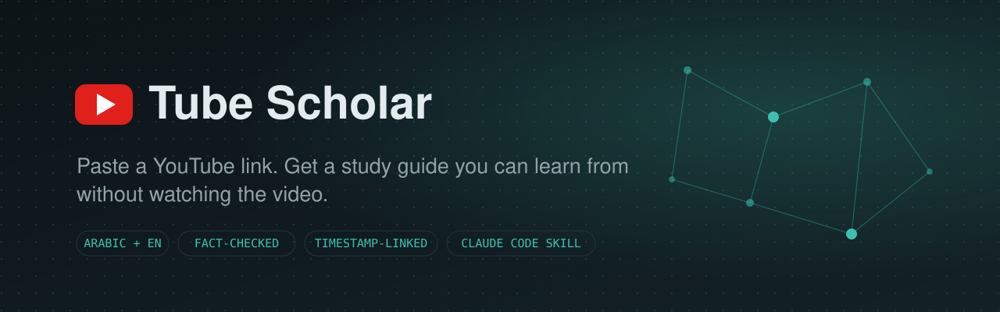
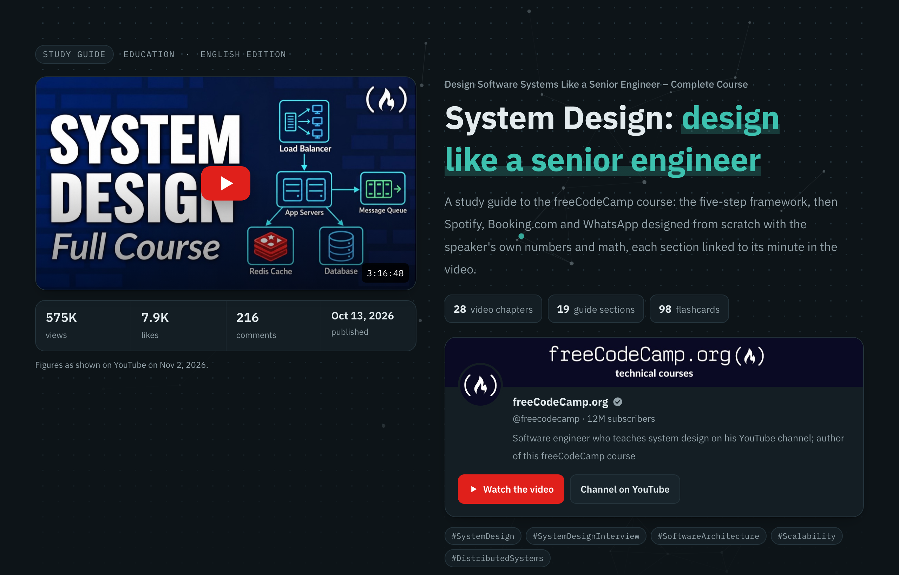
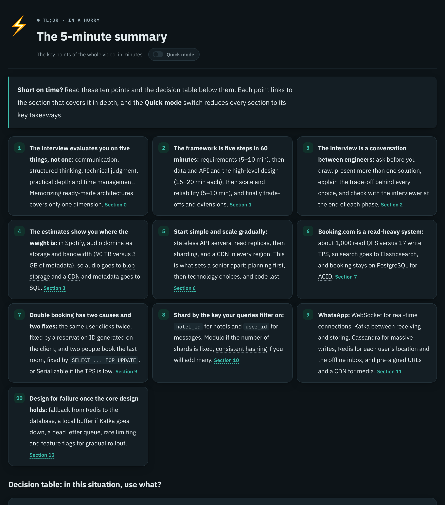
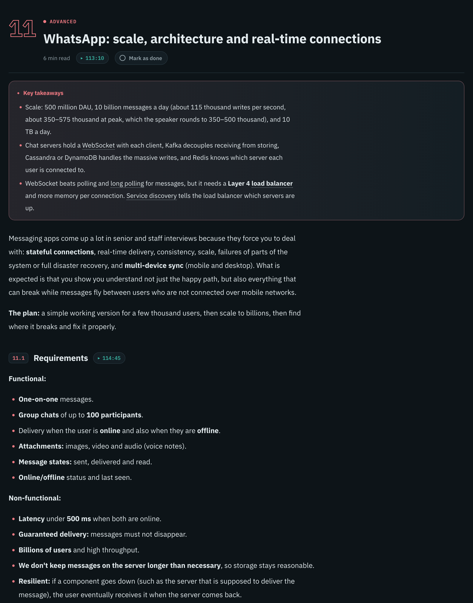
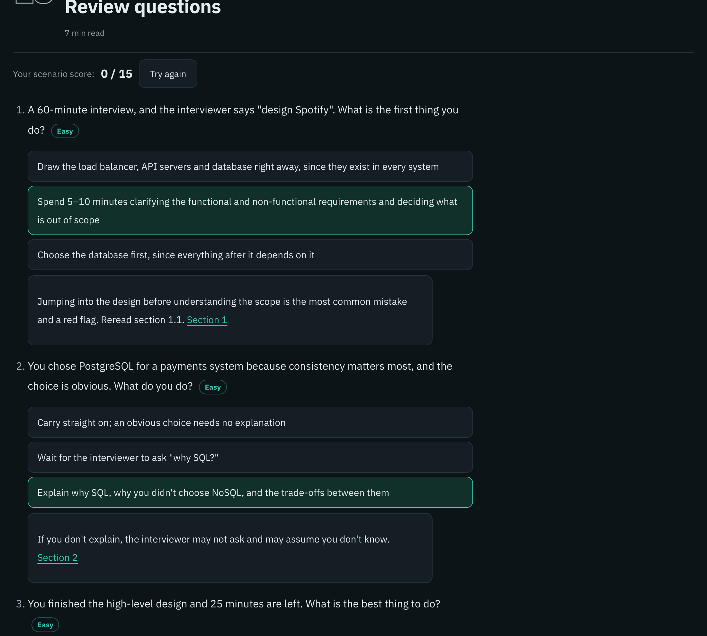
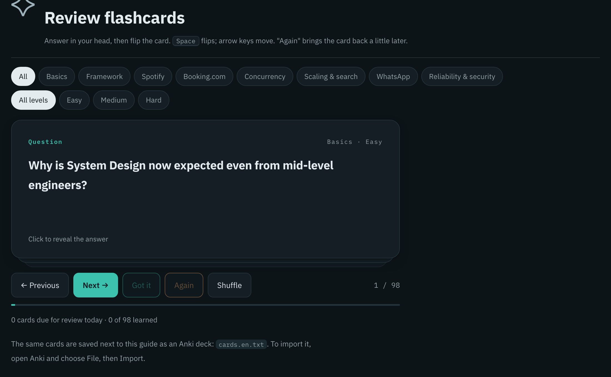
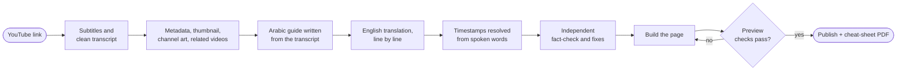
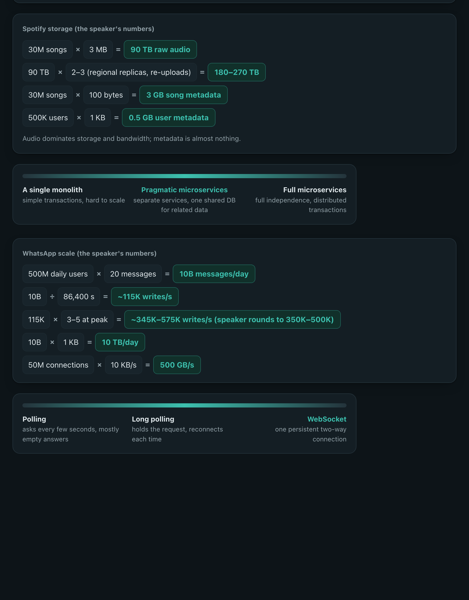
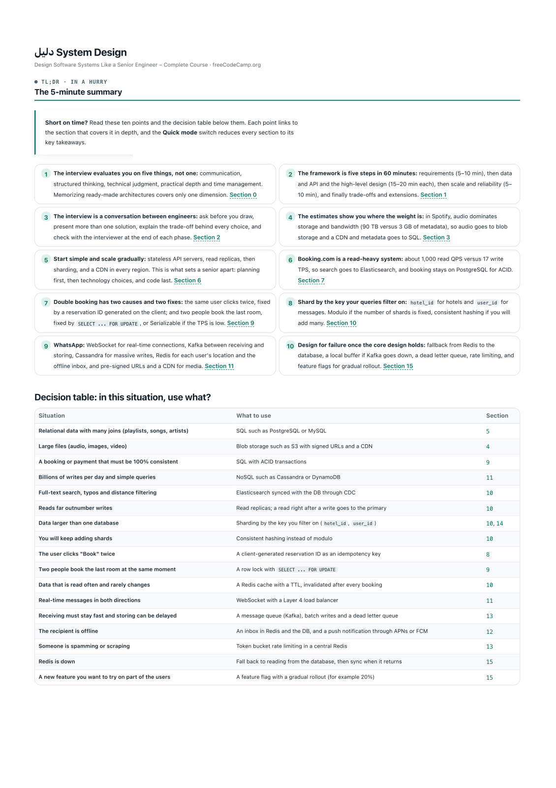
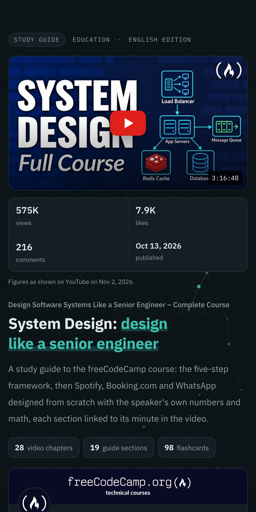

<div align="center">



<br>

[](https://github.com/Shalaby-VBS/tube-scholar/actions/workflows/ci.yml)
[](https://github.com/Shalaby-VBS/tube-scholar/releases)
[](#install)
[](LICENSE)
[](#requirements)
[](https://github.com/yt-dlp/yt-dlp)
[](#what-you-get)

<a href="https://shalaby-vbs.github.io/tube-scholar/demo/"></a>

**[What you get](#what-you-get)** ·
**[Tour](#a-tour-of-a-guide)** ·
**[Install](#install)** ·
**[How it works](#how-it-works)** ·
**[Accuracy](#how-it-stays-accurate)** ·
**[Concept visuals](#concept-visuals)** ·
**[Reference](#reference)** ·
**[FAQ](#faq)**

</div>

---

Tube Scholar is a [Claude Code](https://claude.com/claude-code) skill that turns a YouTube video into a complete, interactive study guide. It reads the entire transcript, writes an academic explanation of everything the speaker teaches in **Arabic and English**, has an independent agent fact-check every number and claim against the transcript, and publishes the result as a single page you can share.

A 38-minute lecture becomes a 5-minute summary. A 3-hour course becomes nineteen sections you can skim, search, quiz yourself on and jump back into the video from, at the exact minute.

**[Open the live demo](https://shalaby-vbs.github.io/tube-scholar/demo/)**: the full guide for a 3-hour freeCodeCamp system-design course, built by this skill. Switch languages, search for "sharding", take the quiz, flip the flashcards.

<div align="center">

</div>

## What you get

<table>
<tr>
<td width="50%" valign="top">

### ⚡ A fast path
- A **5-minute summary**: 8 to 10 points, each linked to its section
- A **decision table**: "in this situation, use what?"
- **Quick mode** collapses every section to its key takeaways

### 📖 The full explanation
- Section by section, faithful to the transcript
- **Key takeaways** and **common mistakes** boxes in every section
- Anything the guide adds is labelled as an **explainer's note**

### ⏱️ Timestamps you can trust
- Every heading links to the minute the speaker starts that topic
- Resolved from word-level caption timings, never typed by hand
- Description chapters re-anchored when their times drift

</td>
<td width="50%" valign="top">

### 🎯 Practice
- **Scenario questions** with a live score, ordered easy to hard
- Open questions with answers behind a button
- **Flashcards with spaced repetition**: due cards first, remembered in your browser

### 🧭 Navigation
- **Search** across headings, text and the glossary
- **Glossary tooltips** on the first use of every term
- Side menu grouped by level, with **per-section progress**

### 📦 Take-aways
- **Arabic (RTL) and English (LTR)** editions on one page
- **Anki decks** and an **A4 cheat-sheet PDF** per language
- A **hub page** for playlists, with progress across videos

</td>
</tr>
</table>

## A tour of a guide

<table>
<tr>
<td width="50%" valign="top" align="center">

<br><sub><b>The 5-minute summary.</b> Ten linked points, glossary terms underlined, and the quick-mode switch.</sub>
</td>
<td width="50%" valign="top" align="center">

<br><sub><b>A section.</b> Level colour, reading time, a link to the minute in the video, and the key takeaways first.</sub>
</td>
</tr>
<tr>
<td width="50%" valign="top" align="center">

<br><sub><b>Scenario questions.</b> Pick an answer to see why, with a running score and difficulty levels.</sub>
</td>
<td width="50%" valign="top" align="center">

<br><sub><b>Flashcards.</b> Filter by topic and level; "Got it" and "Again" drive the spaced-repetition schedule.</sub>
</td>
</tr>
</table>

## Install

**As a Claude Code plugin** (recommended, updates with `/plugin`):

```text
/plugin marketplace add Shalaby-VBS/tube-scholar
/plugin install tube-scholar@tube-scholar
```

**Or as a plain skill:**

```bash
git clone https://github.com/Shalaby-VBS/tube-scholar.git
cp -R tube-scholar/skills/tube-scholar ~/.claude/skills/
```

Then install the one hard dependency:

```bash
brew install yt-dlp        # or: pipx install yt-dlp
```

## Quick start

Give Claude Code a link:

```text
/tube-scholar https://www.youtube.com/watch?v=VIDEO_ID
```

That's it. Claude reads the video, writes both editions, fact-checks them, previews the page and publishes it, then replies with the link and a short report of what it added or corrected.

> [!TIP]
> A bare video link always builds the full guide. Ask for "subtitles", "audio" or "download the video" when you want just the files.

## How it works



| Mode | Triggered by | Output |
|---|---|---|
| **Study guide** *(default)* | a single video link, "explain", "study guide" | the interactive page, Anki decks, cheat-sheet PDFs, fact-check report |
| **Subtitles** | "subtitles", "transcript", or a playlist/channel link | `.vtt` captions plus a clean `.txt` transcript |
| **Audio** | "audio", "mp3" | MP3 at the best available quality |
| **Video** | "download the video" | MP4 up to 1080p |
| **Course hub** | a playlist plus "make guides" | one guide per video and a hub page linking them all |

## How it stays accurate

A study guide is only useful if you can trust it. Every guide goes through four gates before it is published:

| Gate | What it does | What it catches |
|---|---|---|
| **1. Transcript first** | The guide is planned around what the speaker actually teaches, with the description's chapters as the skeleton | Generic filler, topics the video never covers |
| **2. Spoken-word timestamps** | Each heading carries a few words copied from the transcript; `resolve_ts.py` finds them in the word-timed captions | Links to the wrong minute, sections the speaker never said |
| **3. Independent fact-check** | A separate agent audits every number, quoted claim, explainer's note, quiz answer and a sample of flashcards, then writes `audit.md` | Wrong arithmetic, misquotes, dropped caveats, unlabelled additions |
| **4. Pre-publish preview** | Headless Chrome screenshots desktop, phone and every visual, checks for horizontal scroll and parses every Mermaid diagram | Broken layouts, clipped text, diagrams that would render empty |

> [!NOTE]
> On a 3-hour system-design course, the fact-check caught a wrong peak-load calculation, a link 2 minutes late and two claims the speaker never made. All of them were fixed before publishing.

## Concept visuals

Ideas that have a shape get an animated, theme-aware component instead of a plain table. Each one is a fenced block in the guide's Markdown.

<div align="center">

</div>

<table>
<tr><th>Component</th><th>Use it for</th><th>Syntax</th></tr>
<tr><td><code>loop</code></td><td>cycles: an agent loop, a feedback loop, retries. A dot travels the cycle and lights each stage.</td>
<td>

```text
center: ReAct
- Reason: think
- Act: do
- Observe: check
exit: Final Answer: the answer
```

</td></tr>
<tr><td><code>matrix</code></td><td>2×2 trade-offs, with one cell highlighted</td>
<td>

```text
x: Low precision | High precision
y: High complexity | Low complexity
- *Smart start: example
- Very hard: example
- —
- —
```

</td></tr>
<tr><td><code>spectrum</code></td><td>a range of options, with the recommended one marked</td>
<td>

```text
- Polling: asks every few seconds
- Long polling: holds the request
- *WebSocket: one open connection
```

</td></tr>
<tr><td><code>timeline</code></td><td>steps with a time budget, drawn to scale</td>
<td>

```text
total: 60
unit: min
- Requirements: 5–10
- High-level design: 15
- Trade-offs: the rest
```

</td></tr>
<tr><td><code>calc</code></td><td>back-of-the-envelope maths, results highlighted</td>
<td>

```text
- 30M songs × 3 MB = 90 TB
- 90 TB × 2–3 = 180–270 TB
```

</td></tr>
</table>

Every component follows light and dark themes, flips correctly in right-to-left layouts, rises in on scroll and stands still when the reader prefers reduced motion.

## Reference

### Requirements

| Tool | Needed for | Install |
|---|---|---|
| [Claude Code](https://claude.com/claude-code) | running the skill and publishing the page | [docs](https://docs.claude.com/en/docs/claude-code) |
| [yt-dlp](https://github.com/yt-dlp/yt-dlp) | subtitles, metadata, thumbnails | `brew install yt-dlp` |
| Python 3.9+ | every script | preinstalled on macOS |
| [`markdown`](https://pypi.org/project/Markdown/) | the page builder | installed automatically into `~/.cache/tube-scholar/venv` |
| Google Chrome | previews, the Mermaid check, cheat-sheet PDFs | [google.com/chrome](https://www.google.com/chrome/) |
| ffmpeg | audio and video downloads only | `brew install ffmpeg` |

### Output

Every video gets its own folder under `~/Downloads/tube-scholar/`:

```text
<video title>/
├── guide.ar.md · guide.en.md     the explanation, one file per language
├── cards.ar.txt · cards.en.txt   Anki flashcard decks
├── guide.json                    page copy, resources, chapter map
├── audit.md                      the fact-check and how each finding was fixed
├── guide.html                    the published page (generated, never edited by hand)
├── cheatsheet.ar.pdf · .en.pdf   A4 cheat sheets
├── meta/                         video metadata, thumbnail, channel art
└── preview/                      pre-publish screenshots
```

<table>
<tr>
<td width="44%" valign="top" align="center">

<br><sub><b>Playlist hub.</b> Every video's guide in one place, with progress across them.</sub>
</td>
<td width="28%" valign="top" align="center">

<br><sub><b>Cheat sheet.</b> A4 PDF with the summary, decisions, maths and glossary.</sub>
</td>
<td width="28%" valign="top" align="center">

<br><sub><b>On a phone.</b> Responsive, with light and dark themes.</sub>
</td>
</tr>
</table>

### Scripts

| Script | Job |
|---|---|
| [`vtt2txt.py`](skills/tube-scholar/scripts/vtt2txt.py) | Auto-captions to clean, de-duplicated paragraphs |
| [`fetch_meta.py`](skills/tube-scholar/scripts/fetch_meta.py) | Metadata, thumbnail, channel avatar and banner, related videos; any site yt-dlp reads |
| [`lecture_meta.py`](skills/tube-scholar/scripts/lecture_meta.py) | Hand-written metadata for lectures yt-dlp cannot read (Coursera, DRM Udemy courses) |
| [`resolve_ts.py`](skills/tube-scholar/scripts/resolve_ts.py) | `[[ts: spoken words]]` markers to timestamp links; fails on words never said |
| [`build_guide.py`](skills/tube-scholar/scripts/build_guide.py) | The bilingual page from the Markdown, the cards and `guide.json` |
| [`preview_guide.py`](skills/tube-scholar/scripts/preview_guide.py) | Screenshots plus overflow and Mermaid checks; exits non-zero on a problem |
| [`cheatsheet.py`](skills/tube-scholar/scripts/cheatsheet.py) | An A4 cheat-sheet PDF per language |
| [`build_hub.py`](skills/tube-scholar/scripts/build_hub.py) | The playlist hub page |

### Repository layout

```text
tube-scholar/
├── .claude-plugin/
│   ├── plugin.json               plugin manifest
│   └── marketplace.json          lets `/plugin marketplace add` find it
├── skills/tube-scholar/
│   ├── SKILL.md                  what Claude follows, step by step
│   ├── references/
│   │   ├── guide-format.md       the file contract and the quality bar
│   │   └── fact-check-brief.md   the brief for the independent audit agent
│   ├── scripts/                  the pipeline above
│   └── assets/                   page template, styles and behaviour
├── tests/                        end-to-end tests on a bilingual fixture
└── docs/                         README images and the live demo
```

## FAQ

<details>
<summary><b>Does it work for videos that aren't in English?</b></summary>
<br>
The pipeline reads whatever caption track it downloads (English by default). For another source language, ask for that subtitle language; the guide is still written in Arabic and English.
</details>

<details>
<summary><b>Where is the page hosted, and who can see it?</b></summary>
<br>
It is published with Claude's Artifact tool, so it lives at a private claude.ai link. Only you can open it until you share it from the page's Share menu.
</details>

<details>
<summary><b>Where are my progress and flashcard schedule stored?</b></summary>
<br>
Only in your browser's local storage. Nothing about your progress leaves your device.
</details>

<details>
<summary><b>YouTube says "Sign in to confirm you're not a bot" or returns HTTP 429.</b></summary>
<br>
Update yt-dlp first (<code>brew upgrade yt-dlp</code>), then retry with <code>--cookies-from-browser chrome --sleep-requests 1</code>.
</details>

<details>
<summary><b>Can I edit a guide after it is published?</b></summary>
<br>
Yes. Edit the <code>.md</code>, <code>cards.*.txt</code> or <code>guide.json</code> files and ask Claude to rebuild; it re-runs the checks and republishes to the same link. Never edit <code>guide.html</code> directly, because it is regenerated.
</details>

<details>
<summary><b>Is the content mine to share?</b></summary>
<br>
Guides are unofficial study notes. Each page credits the speaker and the channel, keeps their disclaimers, labels sponsored segments and links back to the original video.
</details>

<details>
<summary><b>Does it run on Linux or Windows?</b></summary>
<br>
The scripts are plain Python and run anywhere; CI runs them on Ubuntu. Two conveniences are macOS-only and skip themselves elsewhere: shrinking images with <code>sips</code> and reading PDF thumbnails. The preview and cheat sheet need Google Chrome or Chromium on PATH.
</details>

## Contributing

Bug reports, ideas and pull requests are welcome. Read [CONTRIBUTING.md](CONTRIBUTING.md) for the setup, the tests and the ground rules, and see [CHANGELOG.md](CHANGELOG.md) for what changed in each release.

## Acknowledgements

Built on [yt-dlp](https://github.com/yt-dlp/yt-dlp), [Python-Markdown](https://github.com/Python-Markdown/markdown) and [Mermaid](https://mermaid.js.org/), set in [IBM Plex](https://www.ibm.com/plex/) and [Noto Kufi Arabic](https://fonts.google.com/noto/specimen/Noto+Kufi+Arabic).

## License

Released under the [MIT License](LICENSE). Generated guides are unofficial study notes; the videos, thumbnails and channel art belong to their creators.
