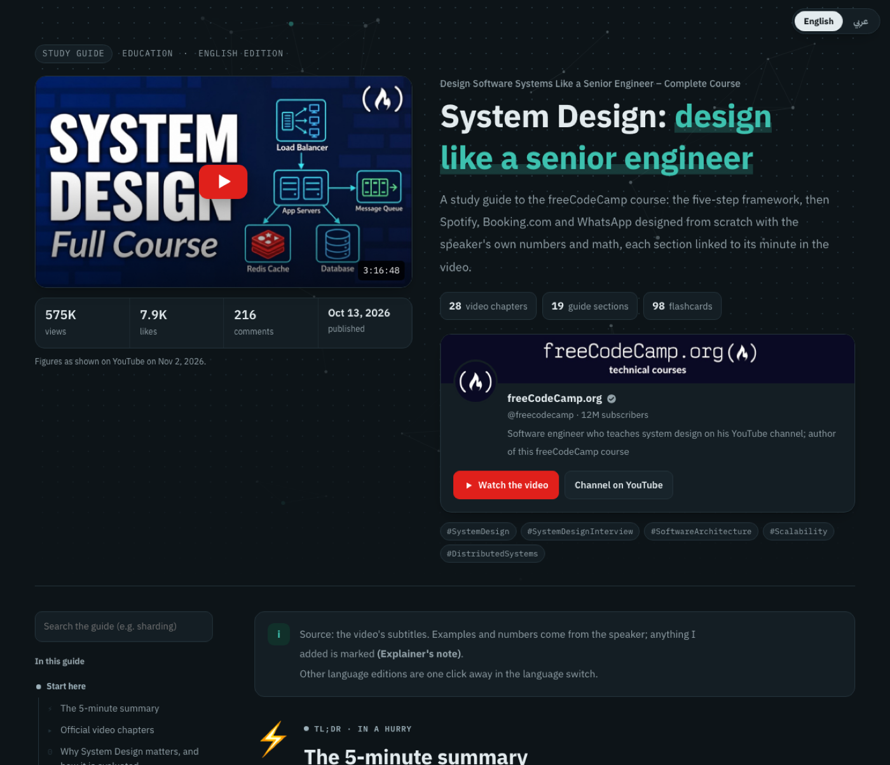
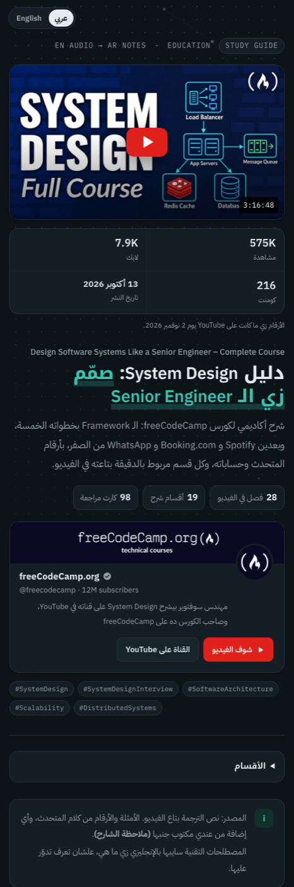
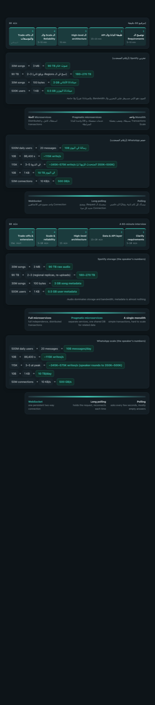
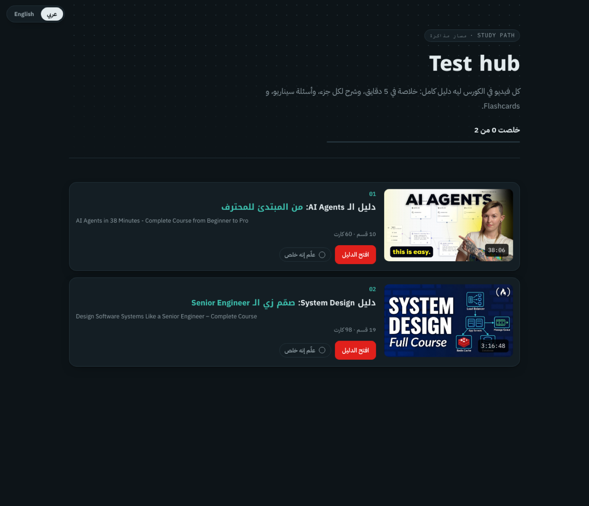
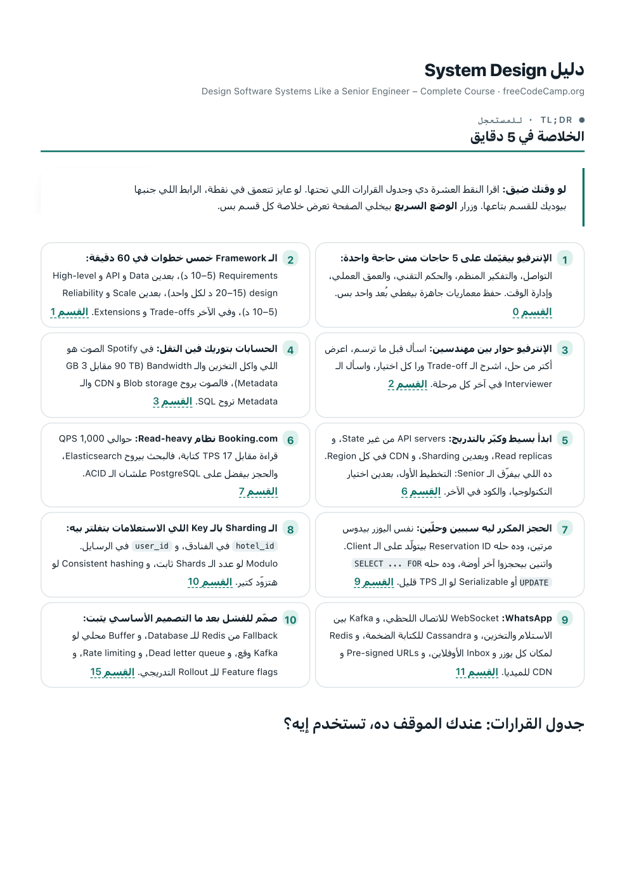

# Tube Scholar

**Paste a YouTube link, get a study guide you can learn from without watching the video.**

Tube Scholar is a [Claude Code](https://claude.com/claude-code) skill. Give it a video and it reads the whole transcript, writes an academic explanation of everything the speaker teaches in Arabic and English, checks it against the transcript with an independent agent, and publishes a single interactive page: a 5-minute summary, every section linked to its exact minute in the video, animated concept diagrams, a scenario quiz, glossary tooltips and spaced-repetition flashcards.



## What you get for every video

| | |
|---|---|
| **Fast path** | A 5-minute summary with 8–10 linked points, a "in this situation, use what?" decision table, and a quick mode that collapses every section to its key takeaways |
| **The explanation** | Section by section, faithful to the transcript, with takeaways and common-mistakes boxes. Anything the guide adds is labelled as an explainer's note |
| **Timestamps you can trust** | Every heading links to the minute the speaker starts that topic. Links are resolved from word-level caption timings, never typed by hand, and the description's chapters are re-anchored to the speech when they drift |
| **Concept visuals** | Animated `loop`, `matrix`, `spectrum`, `timeline` and `calc` components, plus Mermaid diagrams |
| **Practice** | Scenario multiple-choice questions with a score, open questions with hidden answers, Easy/Medium/Hard levels, and flashcards with Leitner spaced repetition (due cards first, kept in your browser) |
| **Navigation** | Search across headings, text and glossary; hover definitions on the first use of every glossary term; a side menu grouped by level, with per-section progress |
| **Two languages** | Arabic (RTL) and English (LTR) editions on one page, with a switch that keeps you on the same section |
| **Take-aways** | Anki decks (`cards.ar.txt`, `cards.en.txt`) and an A4 cheat-sheet PDF per language |
| **Courses** | A playlist gets one guide per video plus a hub page that links them all, with progress across videos |

<p align="center">
  
  
</p>

## How it stays accurate

1. **Transcript first.** The guide is planned around what the speaker actually teaches, using the description's chapters as the skeleton.
2. **Spoken-word timestamps.** Each section carries a few words copied from the transcript; `resolve_ts.py` finds them in the word-timed captions and fails on any phrase the speaker never said.
3. **Independent fact-check.** A separate agent audits every number, quoted claim, explainer's note, quiz answer and a sample of flashcards against the transcript, writes `audit.md`, and every finding is fixed before building. On a 3-hour course it caught a wrong peak-load calculation, a link 2 minutes late and two claims the speaker never made.
4. **Preview before publishing.** Headless Chrome screenshots the page on desktop and phone and every concept visual, checks there is no horizontal scroll at either width, and parses every Mermaid diagram with the real library. Publishing waits until all of that passes.



## Install

```bash
git clone https://github.com/Shalaby-VBS/tube-scholar.git ~/.claude/skills/tube-scholar
```

Requirements:

| Tool | Used for | Install |
|---|---|---|
| [yt-dlp](https://github.com/yt-dlp/yt-dlp) | subtitles, metadata, thumbnails | `brew install yt-dlp` |
| Python 3.9+ | every script | preinstalled on macOS |
| `markdown` (Python) | the page builder | set up automatically in a private venv at `~/.cache/tube-scholar/venv` on first build |
| Google Chrome | preview screenshots, Mermaid check, cheat-sheet PDF | [google.com/chrome](https://www.google.com/chrome/) |
| ffmpeg | only the audio and video download modes | `brew install ffmpeg` |

The page is published with Claude's Artifact tool, so it lives at a private claude.ai link you can share from the page's Share menu.

## Use

In Claude Code:

```
/tube-scholar https://www.youtube.com/watch?v=VIDEO_ID
```

A bare video link builds the full study guide. Other requests switch mode:

| You say | You get |
|---|---|
| a video link, "explain", "study guide" | the study guide (default) |
| "subtitles", "transcript" | `.vtt` subtitles plus a clean `.txt` transcript |
| "audio", "mp3" | MP3 |
| "download the video" | MP4 up to 1080p |
| a playlist or channel link | subtitles for every item; ask for guides to get one per video plus a hub page |

Everything lands in `~/Downloads/yt-grab/<video title>/`:

```
guide.ar.md  guide.en.md     the explanation, one file per language
cards.ar.txt cards.en.txt    Anki flashcards
guide.json                   page copy, resources, chapter map
audit.md                     the fact-check and how each finding was fixed
guide.html                   the published page (regenerated, never edited by hand)
cheatsheet.ar.pdf  .en.pdf   A4 cheat sheets
meta/                        video metadata and images
preview/                     the pre-publish screenshots
```

## How it works

```mermaid
flowchart LR
    A[YouTube link] --> B[Subtitles + transcript]
    B --> C[Metadata, thumbnail,<br/>channel art, related videos]
    C --> D[Arabic guide written<br/>from the transcript]
    D --> E[English translation]
    E --> F[Timestamps resolved<br/>from spoken words]
    F --> G[Independent fact-check<br/>and fixes]
    G --> H[Build the page]
    H --> I[Preview: screenshots,<br/>width and Mermaid checks]
    I --> J[Publish + cheat-sheet PDF]
```



| Script | Job |
|---|---|
| `scripts/vtt2txt.py` | auto-captions to clean, de-duplicated paragraphs |
| `scripts/fetch_meta.py` | metadata, thumbnail, channel avatar and banner, related videos (`--related` or `--related-search`) |
| `scripts/resolve_ts.py` | `[[ts: spoken words]]` markers to timestamp links; fails on words never said |
| `scripts/build_guide.py` | the bilingual page from the Markdown, cards and `guide.json` |
| `scripts/preview_guide.py` | screenshots plus overflow and Mermaid checks; exits non-zero on a problem |
| `scripts/cheatsheet.py` | A4 cheat-sheet PDF per language |
| `scripts/build_hub.py` | the playlist hub page |

The file contract and the quality bar every guide must meet are in [`references/guide-format.md`](references/guide-format.md); the fact-check brief is in [`references/fact-check-brief.md`](references/fact-check-brief.md).

<p align="center">
  
  
</p>

## Notes

- Guides are unofficial study notes. Each page credits the speaker and channel, keeps their disclaimers, labels sponsored segments, and links back to the video.
- Progress, quick mode and flashcard schedules are stored only in the viewer's browser.
- If YouTube answers `HTTP 429` or "Sign in to confirm you're not a bot", run yt-dlp with `--cookies-from-browser chrome --sleep-requests 1`, and keep yt-dlp updated (`brew upgrade yt-dlp`).

## License

[MIT](LICENSE)
